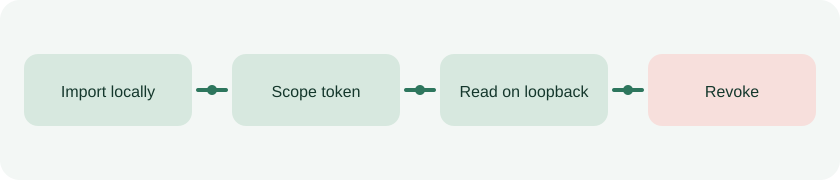

# DataSovereign 1.0

[English](README.md) · [Download](https://github.com/MRJonam91/DataSovereign/releases/latest) · [API](docs/api.md) · [Sicurezza](SECURITY.md)



DataSovereign è un vault locale per un singolo utente Windows. Importi copie cifrate dei tuoi documenti, scegli quali può leggere un'app e le consegni un token temporaneo. Puoi revocarlo quando vuoi e consultare le decisioni registrate nell'audit.

## Installazione e avvio

Servono Windows e Python 3.11 o successivo. Scarica il wheel da [GitHub Releases](https://github.com/MRJonam91/DataSovereign/releases/latest) e apri PowerShell nella cartella dei download:

```powershell
python -m pip install .\datasovereign-1.0.0-py3-none-any.whl
python -m datasovereign serve
```

Se parti dal codice sorgente, installa con `python -m pip install .`. Apri l'URL locale mostrato nel terminale e tienilo privato. La chiave di amministrazione dura fino all'arresto del servizio con Ctrl+C.

Crea una raccolta, importa i documenti e seleziona i file da condividere. Copia il token della delega quando compare. Per un agente AI, autorizza solo i documenti necessari e tieni il suo ambiente separato dalle cartelle originali. L'app invia `Authorization: Bearer <token>` alla [API locale](docs/api.md). I nuovi file importati restano fuori dalle deleghe esistenti. Un documento recuperato dal cestino richiede un nuovo consenso.

## Aggiornamento dall'alfa

Ferma il servizio e copia l'intera cartella del vault. Se avevi installato il vecchio pacchetto, rimuovilo con `python -m pip uninstall datasovereign-alpha`, poi installa la 1.0. La cartella predefinita resta `%LOCALAPPDATA%\DataSovereign\alpha`. Se usavi `--data-dir`, indica lo stesso percorso. Alla prima apertura il programma migra il database e salva una copia dei metadati chiamata `vault.pre-beta.db`. Le vecchie deleghe conservano i documenti disponibili al momento della migrazione. Controllale e revocale se necessario. Per tornare alla versione precedente usa la copia integrale del vault.

## Backup, export e integrità

- **Backup cifrato (64 MiB).** Documenti e manifest sono protetti con Windows DPAPI. Il ripristino richiede lo stesso account Windows, lo stesso dispositivo e un vault vuoto. Le deleghe recuperate sono tutte revocate.
- **Export in chiaro (50 MiB).** Scarica i documenti attivi e i metadati in uno ZIP per trasferirli. Conserva l'archivio in un luogo protetto.
- **Integrità.** Usa `python -m datasovereign doctor` o la verifica nella dashboard. Il limite di importazione è 10 MiB per documento.

L'API funziona solo in locale. Un programma eseguito con il tuo account Windows può leggere i file originali e può tentare di accedere direttamente al vault. I metadati SQLite sono in chiaro. Un destinatario può conservare le copie già scaricate e chi accede direttamente al database può modificare l'audit. Consulta il [modello delle minacce](docs/security/alpha-threat-model.md) prima di usare documenti sensibili.

Codice con licenza [AGPL-3.0-only](LICENSE). Vedi [licenze](LICENSING.md), [condizioni per contribuire](CONTRIBUTING.md), [supporto](SUPPORT.md) e [piano di sviluppo](docs/release-plan.md).

## Sostieni il progetto

Per sostenere la manutenzione puoi usare il pulsante **Sponsor** della repository oppure [Ko-fi](https://ko-fi.com/mrjonam), [Buy Me a Coffee](https://buymeacoffee.com/mrjonam) o [PayPal](https://paypal.me/manorollo).
