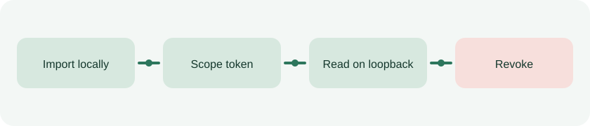

# DataSovereign 1.0

[Italiano](README.it.md) · [Downloads](https://github.com/MRJonam91/DataSovereign/releases/latest) · [API](docs/api.md) · [Security](SECURITY.md)



DataSovereign is a local document vault for one Windows user. Import encrypted copies, choose exactly which documents an application can read, and give it a temporary token. The vault records access decisions and lets you revoke a delegation at any time.

## Install and start

Requires Windows and Python 3.11 or later. Download the wheel from [GitHub Releases](https://github.com/MRJonam91/DataSovereign/releases/latest) and open PowerShell in your download folder:

```powershell
python -m pip install .\datasovereign-1.0.0-py3-none-any.whl
python -m datasovereign serve
```

From a source checkout, use `python -m pip install .` instead. Open the local URL printed in the terminal. Keep the link private. Its administrator key remains valid until you stop the server with Ctrl+C.

In the dashboard, create a collection, import documents and select the files to share. Copy the delegation token when it appears. For an AI agent, grant only the documents it needs and keep its environment separate from the original folders. The application sends `Authorization: Bearer <token>` to the [local API](docs/api.md). New imports never join an existing delegation. Restoring a file from trash requires new consent.

## Upgrade from the alpha

Stop the old service and save a copy of the vault directory with the service stopped. If you installed the old package, uninstall it with `python -m pip uninstall datasovereign-alpha`, then install 1.0. The default directory stays at `%LOCALAPPDATA%\DataSovereign\alpha`. Use the same `--data-dir` if you set a custom directory. The first open migrates the database and saves a metadata copy called `vault.pre-beta.db`. Existing delegations retain the documents available at migration time. Review and revoke them if needed. Use the saved vault copy if you need to run the older version again.

## Backup, export and integrity

- **Encrypted backup (64 MiB):** documents and manifest use Windows DPAPI. Restore with the same Windows account and device into an empty vault. Recovered delegations are revoked.
- **Plaintext export (50 MiB):** active documents and metadata in ZIP format, for portability. Store it securely.
- **Integrity:** run `python -m datasovereign doctor` or use the dashboard to check readability. Each imported document can be up to 10 MiB.

The API is loopback only. Programs that already run as your Windows user can access the original files and may be able to access vault data directly. The SQLite metadata is plaintext. A recipient can keep copies it already downloaded. The application audit can be changed by someone with direct access to the database. See the [threat model](docs/security/alpha-threat-model.md) before using sensitive documents.

Code is licensed under [AGPL-3.0-only](LICENSE). See [licensing](LICENSING.md), [contribution terms](CONTRIBUTING.md), [support](SUPPORT.md), and the [development plan](docs/release-plan.md).

## Support the project

To support maintenance, use the repository's **Sponsor** button or visit [Ko-fi](https://ko-fi.com/mrjonam), [Buy Me a Coffee](https://buymeacoffee.com/mrjonam) or [PayPal](https://paypal.me/manorollo).
