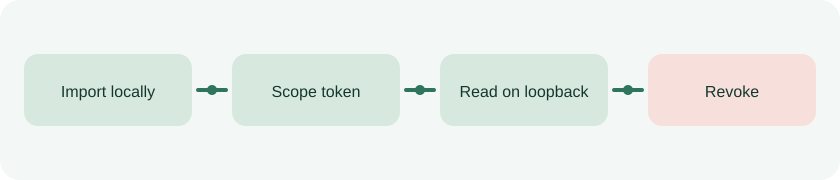

# DataSovereign α

[Italiano](README.it.md) · [Security](SECURITY.md) · [API](docs/api.md)



DataSovereign is a local document vault for one Windows user. It imports encrypted copies of selected files and gives an application temporary, read-only access to one collection through a loopback API. Access can be revoked and decisions are recorded in an audit log.

**Status:** usable local alpha, not independently security audited. Use copies of test documents first. This project is about controlled access, not selling personal data.

## Run locally

Requires Windows and Python 3.11 or later. From this directory:

```powershell
python -m pip install -e .
python -m datasovereign serve
```

The command prints a local URL containing a temporary administrator key. Open it in the browser, import files into a collection and create a delegation. Its token is displayed once. The administrator key expires when the server stops. The default vault directory is `%LOCALAPPDATA%\DataSovereign\alpha`; `--data-dir` can select another directory.

## Application API

Send the delegated token as `Authorization: Bearer <token>` to `http://127.0.0.1:8765`. An application can list and read only within its selected collection until the delegation expires or is revoked. See [API documentation](docs/api.md). The API does not accept filesystem paths.

## Export and limits

The dashboard exports a ZIP containing decrypted documents, collection metadata, delegation records without tokens, and audit entries. **That ZIP is plaintext**: protect it and delete it when no longer needed.

- Imported original files stay in their original locations. Delegation does not restrict a program that already has access to those files under the same Windows account.
- File contents in the vault use Windows user-scoped DPAPI. File names, collection names, delegation metadata and audit entries remain plaintext in SQLite.
- A recipient may retain data downloaded before revocation. The recorded purpose cannot be enforced after delivery.
- Another Windows account or reinstalled Windows cannot decrypt the vault without a future migration and recovery method. Do not make it the only copy of important documents.
- The audit is append-only within the application, not tamper-proof against a device administrator.
- Import limit: 10 MiB per file. Export limit: 50 MiB per vault.

Read the [threat model](docs/security/alpha-threat-model.md) before using the vault with an AI agent. Give the agent only a scoped API token in an isolated environment, not direct access to the Windows folders being protected.

## License and support

Code: [AGPL-3.0-only](LICENSE). See [licensing details](LICENSING.md), [contribution terms](CONTRIBUTING.md), and [support options](SUPPORT.md). Commercial licensing enquiries are described in [COMMERCIAL-LICENSE.md](COMMERCIAL-LICENSE.md).
